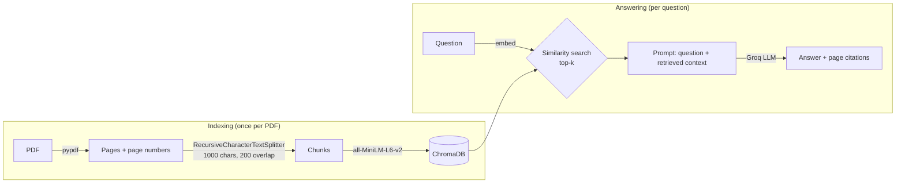

# 📚 AI Research Assistant

[](https://github.com/RijoVins/AI-Research-Assistant/actions/workflows/ci.yml)


**Chat with your PDFs.** Upload a document, ask questions in plain language, and get answers
grounded in the document, with page citations and the exact source passages so every answer can be verified.

Built as a **Retrieval-Augmented Generation (RAG)** pipeline: semantic search over a vector
database finds the relevant passages, and an LLM answers using *only* those passages.

<!-- Add a screenshot of the app here, e.g.:  -->

## ✨ Features

- **Semantic search:** finds passages by *meaning*, not just keywords, using sentence-transformer embeddings and ChromaDB.
- **Grounded, cited answers:** the LLM is instructed to answer only from the retrieved context and cite pages; the UI shows the source passages.
- **Any PDF:** upload from the browser or pass a path on the command line.
- **Smart, persistent indexing:** each PDF is indexed once and cached by content hash. Editing or switching PDFs never serves stale results, and interrupted indexing is detected and rebuilt.
- **Streaming responses** for a responsive chat experience.
- **Polished web UI (Streamlit):** landing page, indexing progress bar, suggested questions, per-document chat history, chat export and friendly error messages.
- **CLI** for terminal use.
- **Tested and CI-checked:** offline test suite (fake embeddings and LLM, no API keys needed) plus linting on GitHub Actions.

## 🏗️ Architecture



## 🧰 Tech stack

| Layer | Technology |
|-------|------------|
| Orchestration | LangChain (LCEL) |
| Embeddings | Hugging Face `sentence-transformers/all-MiniLM-L6-v2` (runs locally) |
| Vector database | ChromaDB (persistent) |
| LLM | Groq (default), or any OpenAI-compatible API: OmniRoute, OpenRouter, Ollama, etc. |
| PDF parsing | pypdf |
| UI | Streamlit |
| Quality | pytest, Ruff, GitHub Actions |

## 🚀 Getting started

**Prerequisites:** Python 3.10+ and an LLM API key: a free [Groq key](https://console.groq.com/keys), or a key for any OpenAI-compatible gateway such as OmniRoute (see [Configuration](#️-configuration)).

```bash
git clone https://github.com/RijoVins/AI-Research-Assistant.git
cd AI-Research-Assistant

python -m venv .venv
source .venv/bin/activate            # Windows: .venv\Scripts\activate

# Optional: CPU-only PyTorch is a much smaller download
pip install torch --index-url https://download.pytorch.org/whl/cpu
pip install -r requirements.txt

cp .env.example .env                 # then add your API key (see Configuration)
```

## 💻 Usage

### Web app

```bash
streamlit run streamlit_app.py
```

Open http://localhost:8501, upload a PDF (or click **Try the sample notes**), and start asking questions.
The first time a PDF is used it's indexed (with a progress bar); after that it loads instantly.

### Command line

```bash
research-assistant                       # chat with the sample PDF
research-assistant path/to/paper.pdf     # chat with any PDF
research-assistant paper.pdf --rebuild   # force re-indexing
research-assistant --help
```

### As a library

```python
from ai_research_assistant import ResearchAssistant

assistant = ResearchAssistant("paper.pdf")
assistant.ensure_index()

answer = assistant.ask("What methodology does the paper use?")
print(answer.text, answer.pages)
```

## ⚙️ Configuration

All settings can be overridden through environment variables or `.env`.

### Choosing the LLM provider

**Groq (default):** set only `GROQ_API_KEY`.

**Any OpenAI-compatible API** (OmniRoute, OpenRouter, Ollama, LM Studio, ...): setting
`LLM_BASE_URL` switches the app to it. Copy the values from your provider's dashboard:

```env
LLM_BASE_URL=http://localhost:PORT/v1      # your OmniRoute endpoint
LLM_API_KEY=your_omniroute_key
LLM_MODEL=model-name-from-your-dashboard
LLM_PROVIDER_NAME=OmniRoute                # optional: name shown in the UI
```

| Variable | Default | Description |
|----------|---------|-------------|
| `GROQ_API_KEY` | | Groq API key (used when `LLM_BASE_URL` is not set) |
| `LLM_BASE_URL` | | Base URL of an OpenAI-compatible API; enables that provider |
| `LLM_API_KEY` | | API key for the OpenAI-compatible provider |
| `LLM_MODEL` | `llama-3.3-70b-versatile` | Chat model name (`GROQ_MODEL` also accepted) |
| `LLM_PROVIDER_NAME` | `OpenAI-compatible API` | Display name in the UI |
| `EMBEDDING_MODEL` | `sentence-transformers/all-MiniLM-L6-v2` | Embedding model |
| `CHUNK_SIZE` / `CHUNK_OVERLAP` | `1000` / `200` | Chunking parameters (characters) |
| `TOP_K` | `4` | Passages retrieved per question |
| `LLM_TEMPERATURE` | `0` | LLM sampling temperature |
| `VECTOR_DB_DIR` | `./chroma_db` | Where indexes are stored |

## 📁 Project structure

```
├── src/ai_research_assistant/
│   ├── assistant.py      # RAG engine: indexing, semantic retrieval, answer generation
│   ├── ingestion.py      # PDF loading and chunking
│   ├── prompts.py        # Grounded QA prompt
│   ├── config.py         # Settings from environment variables
│   └── cli.py            # Command-line interface
├── streamlit_app.py      # Web UI
├── tests/                # pytest suite (offline: fake embeddings and LLM)
├── experiments/          # Early chunking prototypes (fixed-size vs. recursive)
├── data/pdfs/            # Sample PDF
└── .github/workflows/    # CI: lint + tests
```

## 🧪 Testing

```bash
pip install -e ".[dev]"
pytest          # unit + end-to-end UI tests, no network or API key needed
ruff check .    # lint
```

The tests generate small PDFs on the fly and use a deterministic keyword-based embedding
model, so retrieval quality (e.g. "the relevant page is ranked first") is tested without downloading models.

## 🧠 Design decisions

- **Recursive chunking with overlap** splits on paragraphs, then sentences, so chunks stay coherent. The 200-character overlap keeps ideas that span a boundary retrievable (see `experiments/`).
- **Page-level metadata** is attached before chunking, so every retrieved chunk can be cited.
- **Content-hash index keys** mean the same file is never re-embedded, and a changed file never reuses a stale index.
- **Completion marker** means an index counts only once embedding finishes, so a crash mid-indexing can't leave a silently incomplete index.
- **Grounded prompt + temperature 0** reduce hallucination: the model must say when the answer isn't in the document.
- **Dependency injection** (embeddings and LLM passed into `ResearchAssistant`) keeps the core logic testable without network access.

## 🗺️ Roadmap

- [ ] Chat across multiple PDFs at once
- [ ] Hybrid search (BM25 + embeddings) and re-ranking
- [ ] Conversation memory for follow-up questions
- [ ] OCR support for scanned PDFs
- [ ] Docker image and cloud deployment

## 📄 License

[MIT](LICENSE)
